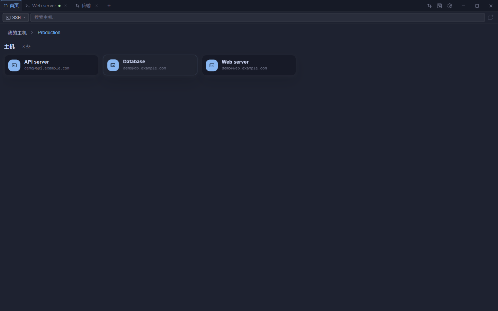
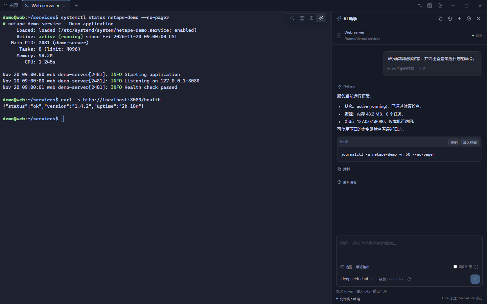
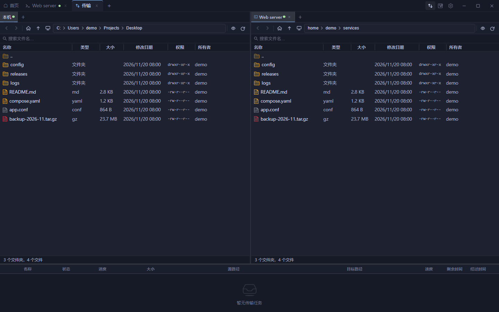
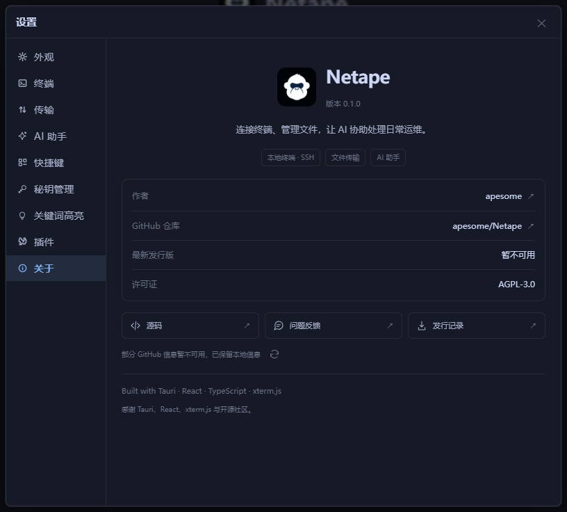
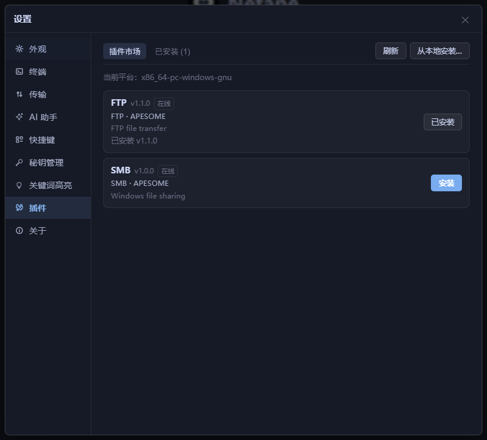

<p align="center"></p>
<h1 align="center">Netape</h1>
<p align="center">Terminal, Dateiübertragung und KI-Unterstützung in einer Desktop-App.</p>
<p align="center"><a href="README.zh-CN.md">简体中文</a> · <a href="README.md">English</a> · <strong>Deutsch</strong> · <a href="README.ja.md">日本語</a></p>
<p align="center"><a href="https://github.com/apesome/Netape/releases">Releases</a> · <a href="https://github.com/apesome/Netape/issues">Fehler melden</a> · <a href="docs/plugin-distribution.md">Plugin-Verteilung</a></p>

Netape ist ein Terminal- und SSH-Client von [apesome](https://github.com/apesome), entwickelt mit Rust, Tauri 2, React und TypeScript. Die Anwendung wird aktiv entwickelt; Windows, macOS und Linux sind die Zielplattformen. Verfügbare Installationspakete richten sich nach dem jeweiligen Release.

## Funktionen

| Bereich | Aktueller Funktionsumfang |
| --- | --- |
| Terminal | Lokale Shell, SSH, Telnet, mehrere Tabs und WSL unter Windows |
| Verbindungen | Hostgruppen, Suche, Baum- und Rasteransichten, Proxy, Sprunghosts und SSH-Tunnel |
| Dateien | Integriertes SFTP mit zwei Dateibereichen und Übertragungsaufgaben; FTP und SMB über Plugins |
| KI-Assistent | OpenAI- und Anthropic-kompatible Dienste, Modellauswahl, Terminalkontext, Verlauf und Befehlsvorschläge |
| Werkzeuge | Notizen, Schlüsselverwaltung, Schlüsselwort-Hervorhebung und Serverinformationen |
| Oberfläche | Helles/dunkles Design, verschiedene Layouts sowie Chinesisch, Englisch, Deutsch und Japanisch |

SMB und WSL sind Windows-spezifisch. KI benötigt einen eigenen Dienst; Guthaben- und Kontingentabfragen hängen vom Anbieter ab. Der KI-Bereich verwendet teilweise englische Texte als Rückfalloption.

## Einblicke

Die Bilder zeigen echte UI-Komponenten mit ausschließlich fiktiven Daten. SSH, Dateien, KI-Antworten und Guthaben sind simuliert; es werden keine echten Konten gezeigt.


*Hostgruppen und Verbindungsverwaltung.*


*Terminalausgabe analysieren und passende Befehle vorschlagen lassen.*


*Lokale und entfernte Dateien nebeneinander.*


*Version, Autor und Projektlinks an einem Ort.*


*Verfügbare Plugins, Versionen und Installation passender Pakete.*

## Einstieg

1. Unter [Releases](https://github.com/apesome/Netape/releases) nach einem passenden Paket suchen. Ist keines vorhanden, aus dem Quellcode bauen.
2. Einen Host mit Adresse, Port und Anmeldung anlegen und öffnen.
3. Über **Übertragung** die Dateien des Hosts verwalten.
4. In den KI-Einstellungen Dienst, API-Schlüssel und Modell hinterlegen. Terminalkontext vor dem Teilen prüfen.
5. Die Sprache unter **Einstellungen → Darstellung → Sprache** wechseln.

## Entwicklung

Voraussetzungen: Node.js 22.18+ (einschließlich der TypeScript-Tests), npm, Rust stable und die [Tauri-Plattformabhängigkeiten](https://v2.tauri.app/start/prerequisites/). Unter Windows werden normalerweise C++ Build Tools, Windows SDK und WebView2 benötigt.

```bash
npm ci
npm run build
cargo run
```

`cargo run` bettet `dist/` beim Kompilieren ein. Nach Frontend-Änderungen zuerst `npm run build` abschließen und dann Cargo starten. `npm run dev` startet nur die Weboberfläche; native Funktionen benötigen Tauri.

```bash
# Desktop-Paket erstellen
npm run tauri -- build
# Frontend-Tests
node --test tests/*.test.mjs
```

Pakete liegen unter `target/release/bundle/`; Rust verwendet je nach Toolchain/Target einen zusätzlichen Target-Unterordner. Weitere Build-Hinweise stehen in der [englischen README](README.md#development).

## Plugins und Beiträge

Der Marktplatz unterstützt einen signierten HTTPS-Katalog, plattformspezifische Downloads, Fortschritt, Abbruch und geprüfte Installation. Lokale Installation bleibt verfügbar. Plugins bestehen aus `plugin.json` und einem separaten Programm mit JSON-RPC; SMB ist Windows vorbehalten.

Die [Veröffentlichungsanleitung](docs/plugin-distribution.md) beschreibt Releases, Signaturschlüssel und Paketskripte. Öffentliche Pakete und der signierte Katalog müssen vor der Online-Installation veröffentlicht werden. Plugins bleiben vorerst mit eigenen Versionen im selben Repository.

Fehlerberichte bitte mit Betriebssystem, App-Version, Schritten zur Reproduktion und bereinigten Logs in [Issues](https://github.com/apesome/Netape/issues) einreichen. Keine Zugangsdaten oder privaten Schlüssel veröffentlichen.

## Lizenz

Lizenz: [AGPL-3.0](LICENSE) (nur Version 3). Drittanbieterhinweise befinden sich unter [licenses/](licenses/).
