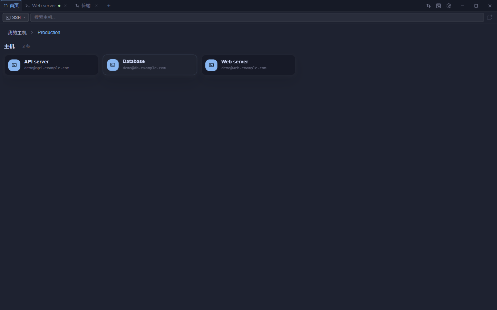
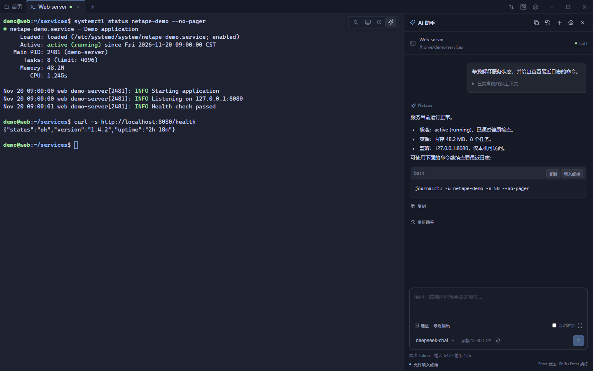
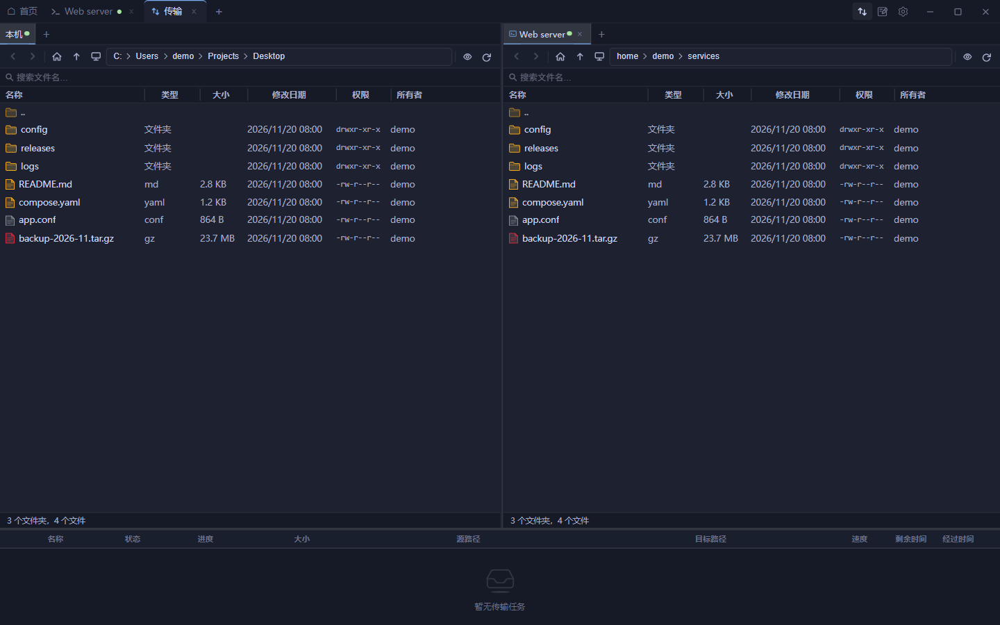
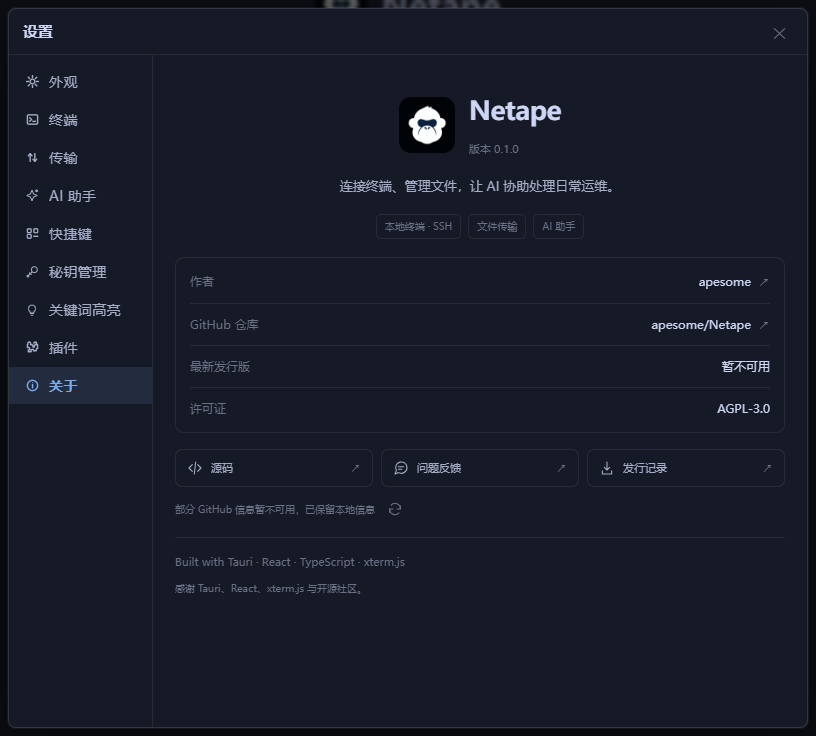
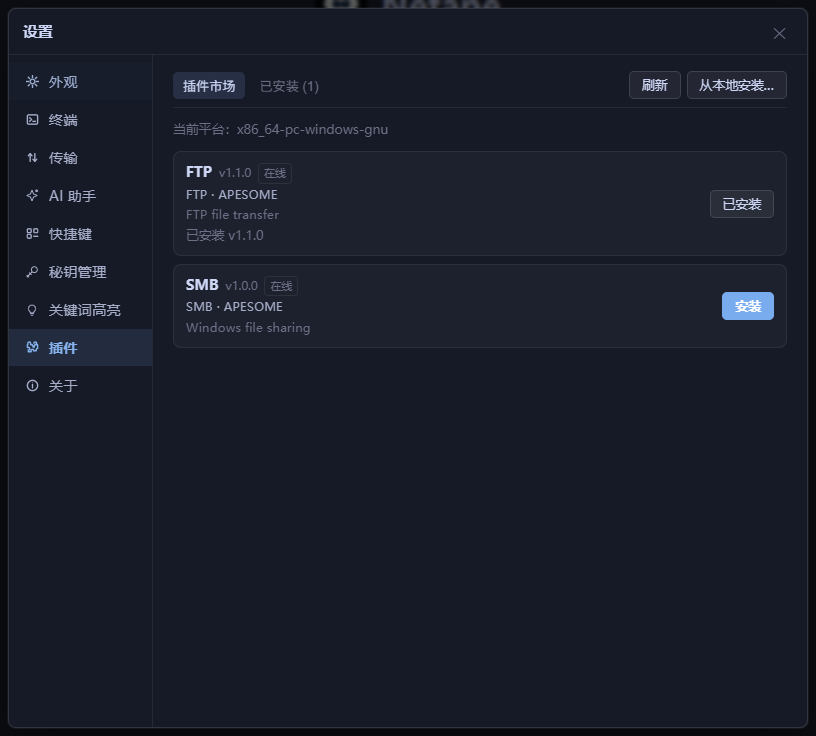

<p align="center"></p>
<h1 align="center">Netape</h1>
<p align="center">ターミナル、ファイル転送、AI アシスタントをひとつのデスクトップへ。</p>
<p align="center"><a href="README.zh-CN.md">简体中文</a> · <a href="README.md">English</a> · <a href="README.de.md">Deutsch</a> · <strong>日本語</strong></p>
<p align="center"><a href="https://github.com/apesome/Netape/releases">リリース</a> · <a href="https://github.com/apesome/Netape/issues">不具合報告</a> · <a href="docs/plugin-distribution.md">プラグイン配布</a></p>

Netape は [apesome](https://github.com/apesome) が開発するターミナル・SSH クライアントです。Rust、Tauri 2、React、TypeScript を採用し、Windows・macOS・Linux を対象に開発しています。現在は開発段階のため、インストーラーの提供状況は各リリースをご確認ください。

| OS | アーキテクチャ | パッケージ |
| --- | --- | --- |
| Windows | x64 | EXE |
| macOS | Intel x64 / Apple Silicon ARM64 | DMG |
| Linux | x64 / ARM64 | DEB / AppImage |

[v1.0.0](https://github.com/apesome/Netape/releases/tag/v1.0.0) から対応するものを選んでください。Linux x64 は Ubuntu 22.04、ARM64 は Ubuntu 24.04 を基準とし、WebKitGTK 4.1 が必要です。macOS は Developer ID 署名・公証未対応です。SHA-256 と、macOS/Linux 向けのソースコミット情報を同梱しています。CI はネイティブビルドとパッケージを確認し、デスクトップ上の対話操作は未検証です。

## 主な機能

| 分野 | 現在の機能 |
| --- | --- |
| ターミナル | ローカルシェル、SSH、Telnet、複数タブ、Windows の WSL |
| 接続管理 | ホストグループ、検索、ツリー・グリッド表示、プロキシ、踏み台、SSH トンネル |
| ファイル | 組み込み SFTP、左右のファイル一覧、転送タスク。FTP・SMB はプラグインで追加 |
| AI | OpenAI／Anthropic 互換サービス、モデル選択、ターミナルの文脈、会話履歴、コマンド提案 |
| ツール | ノート、鍵管理、キーワード強調、サーバー情報 |
| 外観 | ライト・ダークテーマ、複数レイアウト、中国語・英語・ドイツ語・日本語 |

WSL と SMB は Windows 専用です。AI には利用するサービスの設定が必要です。残高や使用量の取得可否はプロバイダーに依存します。AI 画面の一部には英語のフォールバック表示があります。

## スクリーンショット

実際の UI を、架空のホスト・ファイル・AI 応答・残高で撮影しています。接続や AI の動作をシミュレーションしたデモであり、実アカウントの情報は含みません。


*グループと検索で接続先を整理。*


*出力を読み解き、次に使うコマンドを提案。*


*ローカルとリモートのファイルを並べて操作。*


*アプリのバージョン、作者、プロジェクトへのリンク。*


*利用可能なプラグインとバージョンを確認し、対応パッケージを追加。*

## はじめに

1. [リリース](https://github.com/apesome/Netape/releases)で対応パッケージを確認します。未提供の場合はソースからビルドしてください。
2. ホストを追加し、アドレス・ポート・認証情報を設定して接続します。
3. **転送**タブからファイルを管理します。
4. AI 設定でサービス・API キー・モデルを指定します。ターミナルの内容は送信前に確認してください。
5. 表示言語は **設定 → 外観 → 言語** で切り替えます。

## 開発

Node.js 22.18 以降（TypeScript テストを含む）、npm、Rust stable と [Tauri のプラットフォーム要件](https://v2.tauri.app/start/prerequisites/)が必要です。Windows では通常 C++ Build Tools・Windows SDK・WebView2 を使用します。

```bash
npm ci
npm run build
cargo run
```

`cargo run` はコンパイル時に `dist/` を埋め込みます。フロントエンドを変更したら、`npm run build` の完了後に Cargo を実行してください。`npm run dev` は Web UI のプレビュー用で、ネイティブ機能には Tauri が必要です。

```bash
# デスクトップ用パッケージ
npm run tauri -- build
# フロントエンドテスト
node --test tests/*.test.mjs
```

出力先は `target/release/bundle/` です。Toolchain／Target の設定によっては Target 名のサブフォルダーを挟みます。詳しくは[英語版の開発手順](README.md#development)を参照してください。

## プラグインと貢献

署名付き HTTPS 一覧、環境別ダウンロード、進捗、キャンセル、検証付きインストールに対応しました。ローカルからの追加も利用できます。プラグインは `plugin.json` と JSON-RPC で通信する独立した実行ファイルで構成され、SMB は Windows 専用です。

FTP は Windows x64、macOS Intel / Apple Silicon、Linux x64 / ARM64 に対応し、SMB は Windows x64 のみ対応します。[署名付き一覧](https://apesome.github.io/Netape/plugins/v1/index.json)から対応パッケージを自動選択します。[プラグイン公開手順](docs/plugin-distribution.md)と [GitHub リリース手順](docs/github-release.md)をご覧ください。同じリポジトリ内でプラグインごとにバージョン管理します。

[Issues](https://github.com/apesome/Netape/issues)には OS、アプリのバージョン、再現手順、機密情報を除いたログを添えてください。パスワードや秘密鍵は投稿しないでください。

## ライセンス

ライセンスは [AGPL-3.0](LICENSE)（第 3 版のみ）です。第三者のライセンス情報は [licenses/](licenses/) を参照してください。
