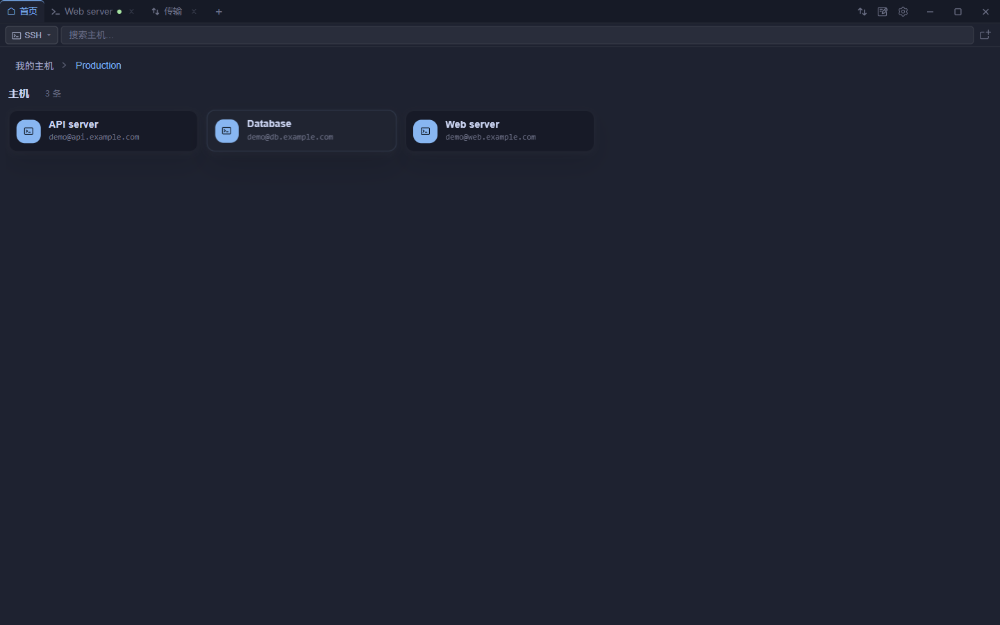
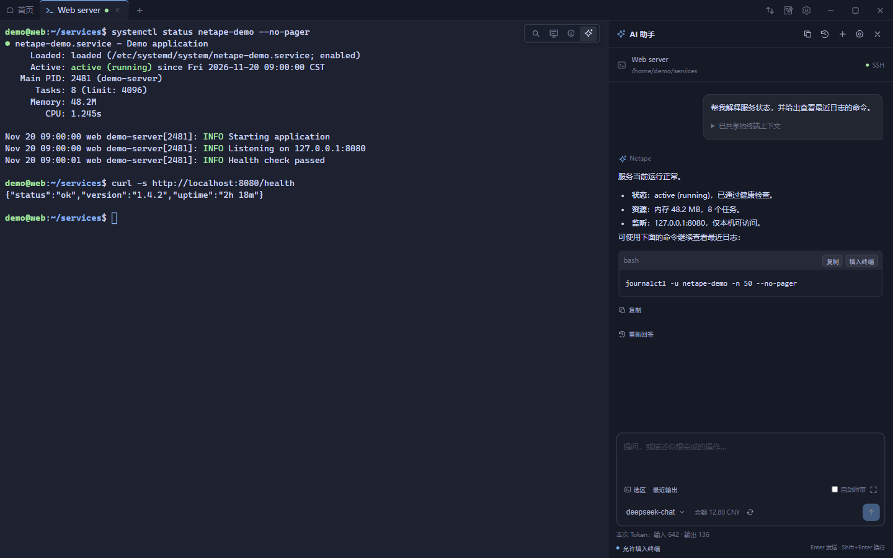
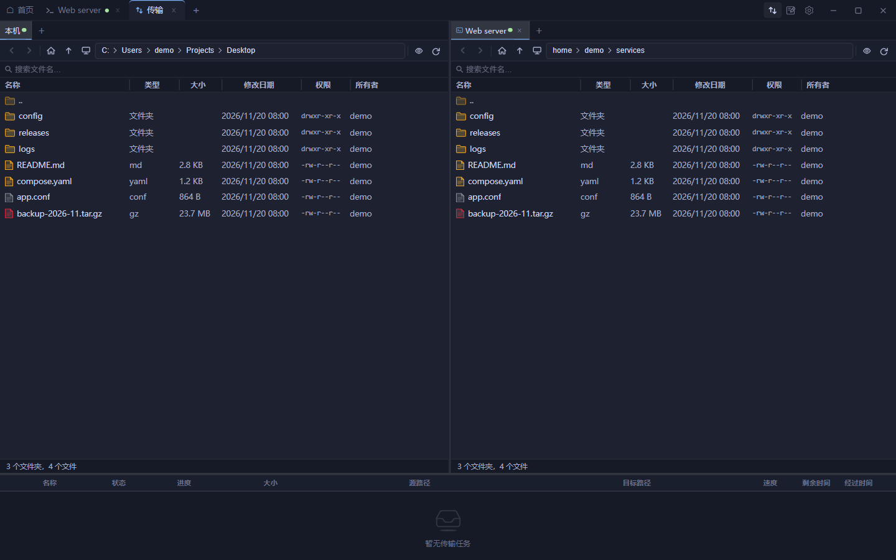
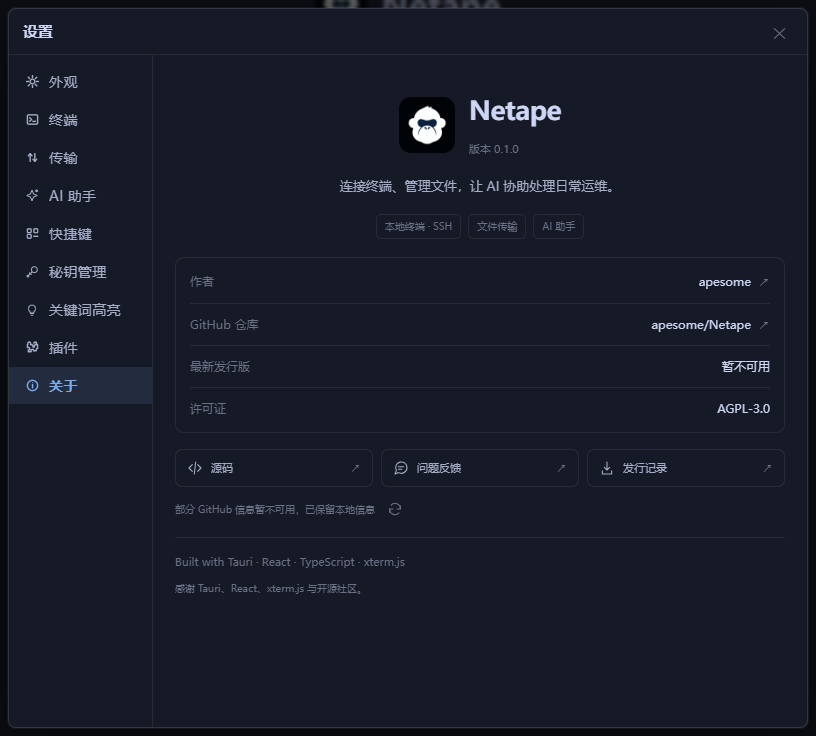
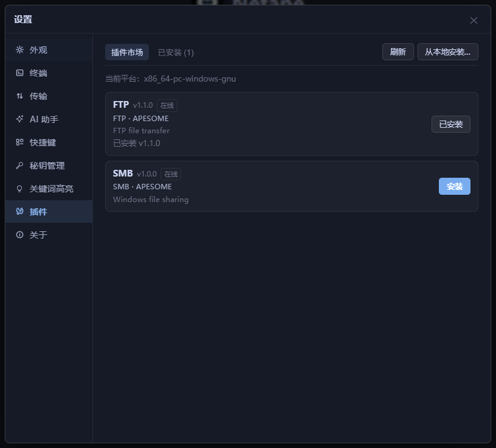

<p align="center"></p>
<h1 align="center">Netape</h1>
<p align="center">Your terminal, files, and AI assistant in one desktop workspace.</p>
<p align="center"><a href="README.zh-CN.md">简体中文</a> · <strong>English</strong> · <a href="README.de.md">Deutsch</a> · <a href="README.ja.md">日本語</a></p>
<p align="center"><a href="https://github.com/apesome/Netape/releases">Releases</a> · <a href="https://github.com/apesome/Netape/issues">Report an issue</a> · <a href="docs/plugin-distribution.md">Plugin distribution</a></p>

**Netape** is a terminal and SSH client by [apesome](https://github.com/apesome), built with Rust, Tauri 2, React, and TypeScript. Connect to servers, manage files, and work through terminal output with an AI assistant without leaving your session.

Netape is under active development. Windows, macOS, and Linux are target platforms; installers and supported architectures depend on the release. Check [Releases](https://github.com/apesome/Netape/releases) for published packages, or build from source.

## Features

| Area | What you can do |
| --- | --- |
| Terminals | Local shells, SSH and Telnet sessions in tabs; WSL on Windows |
| Connections | Host groups, search, tree/grid layouts, proxies, jump hosts and SSH tunnels |
| File transfer | Built-in SFTP, local/remote panes and transfer tasks; FTP and SMB through plugins |
| AI assistant | OpenAI- or Anthropic-compatible services, model selection, shared terminal context, conversation history and command suggestions |
| Everyday tools | Rich-text notes, SSH key management, keyword highlighting and server information |
| Personalization | Light/dark themes, multiple layouts, Chinese, English, German and Japanese interface options |

WSL and SMB are Windows-specific. AI requires your own configured service. Balance and quota queries depend on the provider; some services do not offer them. Parts of the AI interface fall back to English outside Chinese.

## Screenshots

These captures use the real application UI with fictional hosts and files. SSH output, AI responses and balance values are simulated for documentation; no live account or private infrastructure is shown. See [how to reproduce them](docs/screenshots/README.md).


*Organize development and production connections in host groups.*


*Share terminal context, understand output and review suggested commands.*


*Browse local files and remote SFTP directories in one workspace.*


*Installed version, author and project links in Settings → About.*


*Browse available plugins, inspect versions and install compatible packages.*

## Getting started

1. Install a package from [Releases](https://github.com/apesome/Netape/releases), when available, or build from source.
2. Add a host with its address, port and authentication method, then open it to start a session. You can also open a local terminal.
3. Open **Transfer** to browse an SSH host's files. Install a protocol plugin for FTP or SMB.
4. In **Settings → AI assistant**, configure an endpoint, API key and model. Open the assistant from the terminal toolbar. Review terminal context before sharing it with a provider.
5. Switch the interface in **Settings → Appearance → Language**. Use the links above to switch README language.

## Development

Prerequisites: Rust stable, npm, **Node.js 22.18+** (including native TypeScript support for the Node tests), and [Tauri platform dependencies](https://v2.tauri.app/start/prerequisites/). On Windows, normally install Microsoft C++ Build Tools, Windows SDK and WebView2.

From the project root:

```bash
npm ci
npm run build
cargo run
```

`cargo run` embeds `dist/` at compile time. It does not start Vite or build the frontend. After frontend changes, finish `npm run build` before restarting Cargo. Do not run those two builds in parallel.

```bash
# Frontend-only preview; native features require Tauri
npm run dev

# Type-check and build the frontend
npm run build

# Frontend logic tests
node --test tests/*.test.mjs

# Desktop installer (also builds the frontend)
npm run tauri -- build
```

Bundles are written under `target/release/bundle/`, or `target/<target-triple>/release/bundle/` with an explicit Rust target. Packaging requires the corresponding platform's toolchain.

On Windows, a missing `link.exe` normally indicates missing MSVC prerequisites. If you intentionally use an installed GNU Rust toolchain and MinGW, select them explicitly (adjust the path):

```powershell
$env:Path = 'C:\msys64\mingw64\bin;' + $env:Path
cargo +stable-x86_64-pc-windows-gnu run
```

## Plugins

Plugins are separate executables with a `plugin.json` manifest, communicating over JSON-RPC on standard input/output. SFTP is built in; FTP and Windows SMB are separate plugin crates.

The marketplace supports a **signed HTTPS catalog** and target-specific downloads, with progress, cancellation, integrity checks and staged installation. Local-folder installation remains available in **Settings → Plugins**. Plugins are installed under `~/.netape/plugins/<id>/`.

For development, `NETAPE_PLUGIN_CATALOG` points to a local catalog with one subfolder per plugin. The app also looks for `plugins-dist/` beside its executable, then in the source tree. This folder is ignored by Git and is not automatically included in an installer.

The [publishing guide](docs/plugin-distribution.md) covers GitHub Releases, signing keys, package scripts and catalog deployment. Public packages and the signed catalog must be published before online installation becomes available. FTP and SMB remain in this repository with independent versions; a separate plugin repository is optional later.

## Project layout

```text
src/                       React UI, terminals, AI and translations
src-tauri/                 Desktop commands and native integrations
crates/
  netape-domain/           Domain models and managers
  netape-store/            SQLite persistence and settings
  netape-protocol/         SSH, Telnet and proxy support
  netape-pty/              Local terminal abstraction
  netape-terminal/         Terminal core types
  netape-ftp/              FTP plugin executable
  netape-smb/              Windows SMB plugin executable
public/                    Icons and static assets
tests/                     Frontend logic tests
docs/                      Design notes, guides and screenshots
licenses/                  Third-party license notices
```

## Contributing

Open an [issue](https://github.com/apesome/Netape/issues) with your OS, app version, reproduction steps and sanitized logs. UI reports benefit from screenshots. Never include passwords, API keys or private keys.

For code changes, describe the resulting behavior and validation. Run the frontend build and relevant tests; Rust changes also need the appropriate Cargo checks. See the [AI assistant notes](docs/ai-assistant.md) for that subsystem's design.

## License

Licensed under [AGPL-3.0](LICENSE) (version 3 only). Third-party notices are kept in [licenses/](licenses/).
