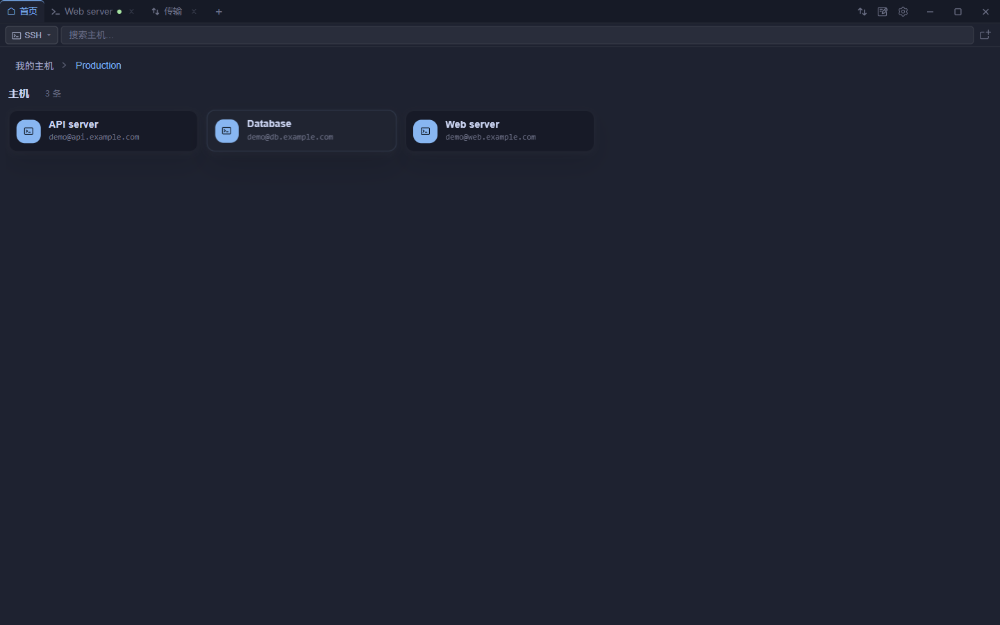
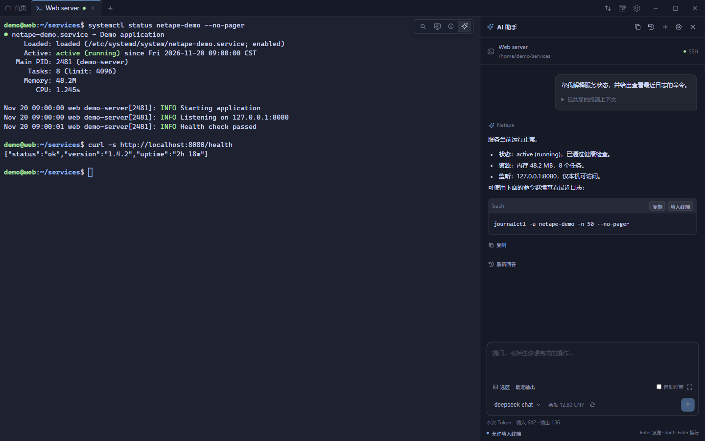
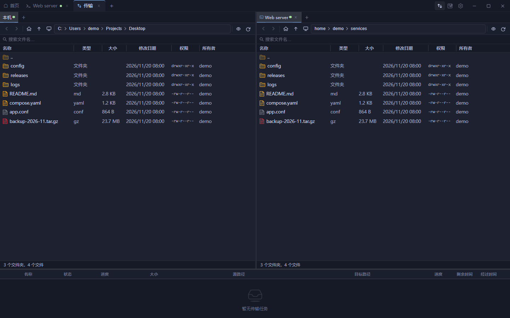
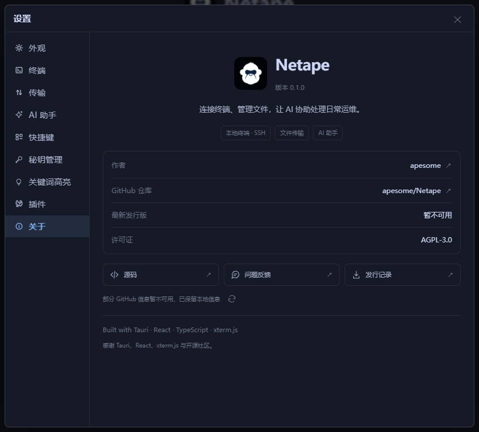
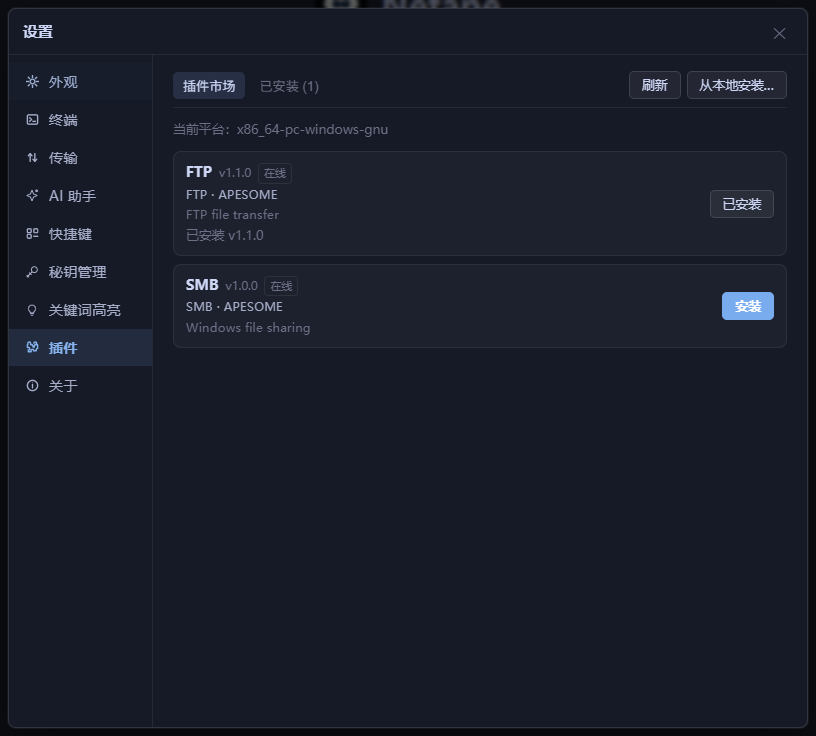

<p align="center"></p>
<h1 align="center">Netape</h1>
<p align="center">连接终端、管理文件，让 AI 协助处理日常运维。</p>
<p align="center"><strong>简体中文</strong> · <a href="README.md">English</a> · <a href="README.de.md">Deutsch</a> · <a href="README.ja.md">日本語</a></p>
<p align="center"><a href="https://github.com/apesome/Netape/releases">发行版本</a> · <a href="https://github.com/apesome/Netape/issues">问题反馈</a> · <a href="docs/plugin-distribution.md">插件分发方案</a></p>

**Netape** 是由 [apesome](https://github.com/apesome) 开发的终端与 SSH 客户端，使用 Rust、Tauri 2、React 和 TypeScript 构建。在一个桌面工作区里完成服务器连接、文件管理和 AI 辅助排查。

项目正在持续开发，面向 Windows、macOS 和 Linux。安装包与架构支持以实际发行版本为准；可在[发行页面](https://github.com/apesome/Netape/releases)查看，尚无对应安装包时可从源码构建。

## 功能概览

| 功能 | 当前支持 |
| --- | --- |
| 终端会话 | 本地 Shell、SSH、Telnet、多标签页，以及 Windows 下的 WSL |
| 主机管理 | 分组、搜索、树形与网格视图、代理、跳板机、SSH 隧道 |
| 文件传输 | 内置 SFTP、本地与远程双栏浏览、传输任务列表；通过插件扩展 FTP 和 SMB |
| AI 助手 | 接入 OpenAI / Anthropic 兼容服务、选择模型、共享终端选区或输出、会话历史、命令建议 |
| 常用工具 | 富文本笔记、SSH 密钥管理、关键词高亮、服务器信息查看 |
| 个性化 | 深浅色主题、多种布局，中文、英文、德文、日文界面选项 |

WSL 与 SMB 仅适用于 Windows。AI 需要自行配置服务；余额、额度查询取决于供应商是否提供接口。AI 界面部分文案在非中文语言下使用英文回退。

## 功能截图

以下截图来自实际应用界面，使用虚构主机、目录和文件。SSH 输出、AI 回复及余额为文档演示数据，不涉及真实账户或内网环境。可参考[截图复现说明](docs/screenshots/README.md)更新图片。


*通过分组整理开发与生产环境，集中查找和打开连接。*


*共享终端上下文、理解输出并获取命令建议，确认后再使用。*


*本地与远程 SFTP 目录并排展示，文件浏览与传输集中处理。*


*在「设置 → 关于」查看本机版本、作者及项目入口。*


*查看可用插件与版本，安装适用于当前平台的插件包。*

## 快速上手

1. 从[发行页面](https://github.com/apesome/Netape/releases)获取已发布的安装包，或按下方说明从源码构建。
2. 新建主机，填写地址、端口及认证方式，打开主机进入终端；也可新建本地终端。
3. 打开「传输」浏览 SSH 主机文件。使用 FTP / SMB 前先安装对应协议插件。
4. 在「设置 → AI 助手」配置服务地址、API Key 和模型，再从终端工具栏打开助手。共享终端内容前请先检查上下文。
5. 在「设置 → 外观 → 语言」切换应用语言；本文顶部链接用于切换 README 语言。

## 本地开发

准备 Rust stable、npm、**Node.js 22.18 或更新版本**（包含直接导入 TypeScript 的 Node 测试支持），并安装 [Tauri 平台依赖](https://v2.tauri.app/start/prerequisites/)。Windows 通常需要 Microsoft C++ Build Tools、Windows SDK 和 WebView2。

在项目根目录执行：

```bash
npm ci
npm run build
cargo run
```

`cargo run` 在编译时嵌入 `dist/`，不会自动启动 Vite，也不会执行前端构建。修改前端后，请先等待 `npm run build` 完成，再启动 Cargo，避免并行构建造成资源缺失。

```bash
# 仅预览前端；终端、存储与传输等原生能力需要 Tauri
npm run dev

# 前端类型检查与构建
npm run build

# 前端逻辑测试
node --test tests/*.test.mjs

# 生成桌面安装包（包含前端构建）
npm run tauri -- build
```

安装包通常位于 `target/release/bundle/`；指定 Rust target 时为 `target/<target-triple>/release/bundle/`。各平台打包仍需要对应的系统工具链。

Windows 如果提示找不到 `link.exe`，请检查 MSVC 环境。若有意使用已安装的 GNU Rust / MinGW，可在 PowerShell 显式指定工具链（按本机位置调整路径）：

```powershell
$env:Path = 'C:\msys64\mingw64\bin;' + $env:Path
cargo +stable-x86_64-pc-windows-gnu run
```

## 插件扩展

插件由 `plugin.json` 与独立可执行程序组成，通过标准输入输出上的 JSON-RPC 与主程序通信。SFTP 为内置能力；FTP 与 Windows SMB 使用独立插件 crate。

插件市场已支持**签名 HTTPS 索引**与按平台下载，包含进度、取消、完整性校验和暂存安装。「设置 → 插件」中继续支持从本地目录安装，安装位置为 `~/.netape/plugins/<id>/`。

开发时可通过 `NETAPE_PLUGIN_CATALOG` 指定本地插件目录，每个插件一个子目录。程序还会依次查找可执行文件旁和源码根目录中的 `plugins-dist/`。该目录被 Git 忽略，现有桌面打包配置也不会自动携带其内容。

Windows x64 的 FTP、SMB 插件包与[签名索引](https://apesome.github.io/Netape/plugins/v1/index.json)已上线，可在设置中在线安装。详见[插件发布指南](docs/plugin-distribution.md)和 [GitHub 打包发布指南](docs/github-release.md)。FTP、SMB 暂时同仓库维护、独立版本发布，以后可迁入独立插件仓库。

## 项目结构

```text
src/                       React 界面、终端视图、AI 与翻译
src-tauri/                 桌面命令与原生系统集成
crates/
  netape-domain/           领域模型与管理器
  netape-store/            SQLite 存储与设置
  netape-protocol/         SSH、Telnet 与代理协议
  netape-pty/              本地终端抽象
  netape-terminal/         终端基础类型
  netape-ftp/              FTP 插件程序
  netape-smb/              Windows SMB 插件程序
public/                    图标等静态资源
tests/                     前端逻辑测试
docs/                      设计说明、指南与功能截图
licenses/                  第三方许可声明
```

## 反馈与贡献

请在 [Issues](https://github.com/apesome/Netape/issues) 中附上操作系统、应用版本、复现步骤和脱敏日志；界面问题建议附截图。不要提交密码、API Key 或私钥。

提交修改时说明解决的问题、最终行为及验证结果。前端修改运行构建和相关测试，Rust 修改同时执行对应 Cargo 检查。AI 子系统可参考 [AI 助手设计说明](docs/ai-assistant.md)。

## 许可证

本项目采用 [AGPL-3.0](LICENSE)（仅第 3 版）。第三方许可声明保留在 [licenses/](licenses/) 中。
