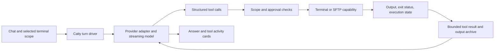

# Netcatty built-in AI review

Reviewed public source at commit [`83d0d5f949af1fc0cfd425e4b3606da027d24473`](https://github.com/binaricat/Netcatty/tree/83d0d5f949af1fc0cfd425e4b3606da027d24473) on 2026-11-16. Source was read without installing or executing Netcatty. This task only changes Netape's toolbar-dialog dimensions; the AI features below are recommendations, not newly integrated functionality.

## Finding

Netcatty is a highly relevant reference because its native Catty Agent operates on live SSH/local terminals, rather than just displaying chat next to a terminal. “Built-in” refers to the agent runtime, tools and UI shipped in the application. Inference uses a configured provider, including compatible local services; it does not imply a bundled language model.

It has two separate integration paths:

1. **Catty Agent:** an application-owned model/tool loop, using Vercel AI SDK `streamText`, provider adapters, a capability catalog, approvals and application terminal/file operations.
2. **External agents:** separate SDK/CLI drivers, including Claude and Codex. These bridge external agent sessions to Netcatty's tools (MCP/CLI integration), permissions and UI. The built-in path does not require installing those external CLIs.

Netcatty uses Electron/Node and React/TypeScript. Netape uses Tauri/Rust and React/TypeScript. Its behavior and contracts translate well, while Electron IPC, Node workers and SDK process hosts require a Rust/Tauri implementation or an explicitly chosen sidecar.

## Built-in flow

[`cattyTurnDriver.ts`](https://github.com/binaricat/Netcatty/blob/83d0d5f949af1fc0cfd425e4b3606da027d24473/infrastructure/ai/harness/turnDrivers/cattyTurnDriver.ts) assembles context, tools, model and compaction. [`cattyStreamProcessor.ts`](https://github.com/binaricat/Netcatty/blob/83d0d5f949af1fc0cfd425e4b3606da027d24473/infrastructure/ai/harness/turnDrivers/cattyStreamProcessor.ts) invokes `streamText` with tools, approval handling, abort signal, timeouts, a maximum step count and per-step context preparation. It maps streamed text, reasoning, tool calls/results and approval events into UI messages.

## Most useful parts for Netape

| Area | Verified Netcatty implementation | What Netape can adopt |
| --- | --- | --- |
| Structured agent loop | AI SDK tools and a step-limited streamed loop; tool results become subsequent model input | Extend Rust messages/SSE beyond text deltas to structured tool calls/results. Begin with inspect-terminal, run-command and read-output. Keep backend validation authoritative. |
| Interactive terminal execution | [`cattyExecHandlers.cjs`](https://github.com/binaricat/Netcatty/blob/83d0d5f949af1fc0cfd425e4b3606da027d24473/electron/bridges/aiBridge/cattyExecHandlers.cjs) prefers a live PTY, checks shell readiness and chooses shell-aware execution; an independent SSH channel is a fallback | Make a robust PTY execution adapter so approved AI commands can use the user's current directory, environment and virtualenv, and remain visible in the terminal. Keep independent SSH execution explicitly labeled. |
| Command boundaries and shell state | [`ptyExec.cjs`](https://github.com/binaricat/Netcatty/blob/83d0d5f949af1fc0cfd425e4b3606da027d24473/electron/bridges/ai/ptyExec.cjs) uses unique command markers, start/end parsing, exit codes, shell-specific wrapping, idle/prompt tracking, cancellation and timeout recovery. [`shellReadinessState.cjs`](https://github.com/binaricat/Netcatty/blob/83d0d5f949af1fc0cfd425e4b3606da027d24473/electron/bridges/ai/shellReadinessState.cjs) distinguishes ready, busy and unknown | Avoid guessing completion from a quiet screen. Validate idle shell state and detect password prompts/fullscreen programs. Prefer shell integration when available; unknown state should be surfaced to the user. |
| Session scope and serialization | [`toolExecutors.ts`](https://github.com/binaricat/Netcatty/blob/83d0d5f949af1fc0cfd425e4b3606da027d24473/infrastructure/ai/shared/toolExecutors.ts) checks the target against the authorized session list. [`sessionExecutionQueue.ts`](https://github.com/binaricat/Netcatty/blob/83d0d5f949af1fc0cfd425e4b3606da027d24473/infrastructure/ai/shared/sessionExecutionQueue.ts) queues work per session; the bridge also reserves an execution lock | Bind every tool request/approval to the originating conversation, terminal session generation and command arguments. Serialize operations on one terminal, and invalidate pending approvals on disconnect/reconnect. |
| Read terminal context on demand | [`terminalContextRead.ts`](https://github.com/binaricat/Netcatty/blob/83d0d5f949af1fc0cfd425e4b3606da027d24473/domain/terminalContextRead.ts) supports viewport/tail/head/line ranges, max-line bounds, live/snapshot source and alternate-screen information | Upgrade the current attach-selection/last-lines feature to a bounded read-only tool. Include line numbers, range metadata and a clear indication of truncated or alternate-screen output. |
| Long-running jobs | [`terminal.cjs`](https://github.com/binaricat/Netcatty/blob/83d0d5f949af1fc0cfd425e4b3606da027d24473/electron/capabilities/catalog/terminal.cjs) defines execute/start/poll/stop capabilities | Add background command handles with incremental output and explicit stop, instead of forcing all work through one request timeout. |
| Unified capability registry | [`capabilityTools.ts`](https://github.com/binaricat/Netcatty/blob/83d0d5f949af1fc0cfd425e4b3606da027d24473/infrastructure/ai/harness/capabilityTools.ts) builds SDK tools from generated capability specs, including write/approval policies and typed input schemas. The catalog covers terminals, SFTP, host/notes records and more | Define one registry for permission policy, input validation and execution. Reuse it for native AI first, and optionally MCP later. Start with a small scoped tool set. |
| Permissions | [`cattyToolApproval.ts`](https://github.com/binaricat/Netcatty/blob/83d0d5f949af1fc0cfd425e4b3606da027d24473/infrastructure/ai/harness/cattyToolApproval.ts) implements observer/confirm/auto behavior, with writes governed by capability policy. Command filtering is supplementary, not its primary boundary | Retain Netape's explicit approvals for writes. Separate read-only inspection from side effects; show target, command and working directory. Do not silently introduce automatic execution. |
| Output storage and context budget | [`toolOutputStore.ts`](https://github.com/binaricat/Netcatty/blob/83d0d5f949af1fc0cfd425e4b3606da027d24473/infrastructure/ai/harness/toolOutputStore.ts) tracks scoped output handles and supports head/tail/range/search reads. [`cattyRuntime.ts`](https://github.com/binaricat/Netcatty/blob/83d0d5f949af1fc0cfd425e4b3606da027d24473/infrastructure/ai/harness/cattyRuntime.ts) and [`contextBudget.ts`](https://github.com/binaricat/Netcatty/blob/83d0d5f949af1fc0cfd425e4b3606da027d24473/infrastructure/ai/harness/contextBudget.ts) implement token-aware compaction and preserve recoverable context | Replace simple character truncation with bounded output artifacts, searchable handles and conversation summaries. Keep recent goals, approved actions and unfinished work through compaction. |
| Provider protocols | [`providers.ts`](https://github.com/binaricat/Netcatty/blob/83d0d5f949af1fc0cfd425e4b3606da027d24473/infrastructure/ai/sdk/providers.ts) creates OpenAI, Anthropic and Google adapters. OpenAI Chat Completions is default, with opt-in Responses. A custom fetch maps SDK requests through Electron IPC, substituting real credentials in the privileged process | Add Rust transport adapters behind a stable streaming event contract. Each new protocol needs real request/stream/tool/history tests. Preserve OS keyring and do not put raw provider credentials into renderer model objects. |
| Stop lifecycle | [`agentStop.ts`](https://github.com/binaricat/Netcatty/blob/83d0d5f949af1fc0cfd425e4b3606da027d24473/infrastructure/ai/harness/agentStop.ts) aborts model requests, clears pending approvals, cancels tools/external agents and marks the conversation cancelled | One stop operation should cover the entire turn, including queued tools and late callbacks. Do not leave commands executing after chat merely stops rendering. |
| Privacy | [`aiPrivacyService.cjs`](https://github.com/binaricat/Netcatty/blob/83d0d5f949af1fc0cfd425e4b3606da027d24473/electron/shared/aiPrivacyService.cjs) pins policy per conversation and manages reversible alias maps in the main process. Model-visible data also has secret redaction | Improve data minimization and backend-owned context redaction. Reversible aliases need strict session lifecycle/validation before becoming executable arguments. This is more complex than API-key storage. |
| Tool activity UI | [`ToolCallGroup.tsx`](https://github.com/binaricat/Netcatty/blob/83d0d5f949af1fc0cfd425e4b3606da027d24473/components/ai/ToolCallGroup.tsx), streamed message parts and artifact cards | Show running/completed/failed/cancelled steps, approval prompts, command targets, output and exit status in chat. Retain a reviewable execution trace. |

## External agents

The Claude driver uses `@anthropic-ai/claude-agent-sdk`, a local CLI and injected Netcatty tools. The Codex driver wraps `@openai/codex-sdk` with resumable sessions and injected MCP tools. Source: [`claudeDriver.cjs`](https://github.com/binaricat/Netcatty/blob/83d0d5f949af1fc0cfd425e4b3606da027d24473/electron/bridges/aiBridge/sdk/claudeDriver.cjs), [`codexDriver.cjs`](https://github.com/binaricat/Netcatty/blob/83d0d5f949af1fc0cfd425e4b3606da027d24473/electron/bridges/aiBridge/sdk/codexDriver.cjs). These are optional backends, with separate authentication, binary discovery, process cancellation and event translation. They are not a shortcut for safely attaching an arbitrary CLI to a remote terminal.

## Recommended Netape sequence

1. **Build a reliable terminal tool layer:** session scope/generation, per-session execution lock, PTY command boundaries, idle-shell detection, output/exit status, bounded output and cancellation. Keep confirmation mode.
2. **Add a native tool loop:** parse streamed tool calls, validate arguments, request approval, execute the bound tool, feed results back automatically and continue up to an explicit step limit. Render structured activity cards. This is the main functional gap from the current code-block actions.
3. **Improve context:** on-demand terminal reads, output handles, summaries and token budgets. Add a small read-only SFTP tool set, then separately reviewed writes.
4. **Extend protocols:** native Anthropic and optional Responses/Gemini adapters, maintaining one internal event/message/tool format.
5. **Add MCP/external agents only if needed:** first expose the same scoped native tools, then implement CLI/SDK lifecycle adapters. Multi-host/workspace operation should require explicit session selection, rather than inheriting all open hosts.

Netape can keep its Rust backend and assistant-ui presentation. Copying the Electron/Node runtime wholesale would introduce a second desktop/service runtime and duplicate existing SSH/SFTP/session ownership. Reimplementing these boundaries natively is the smaller operational design.

## License and limits

The repository's [`LICENSE`](https://github.com/binaricat/Netcatty/blob/83d0d5f949af1fc0cfd425e4b3606da027d24473/LICENSE) is GPL-3.0. Any future direct code reuse must be checked against Netape's distribution/license obligations and retain required notices. This review copies no AI implementation into Netape. Findings are based on the pinned source snapshot, not a live Netcatty execution or vendor-model test.
